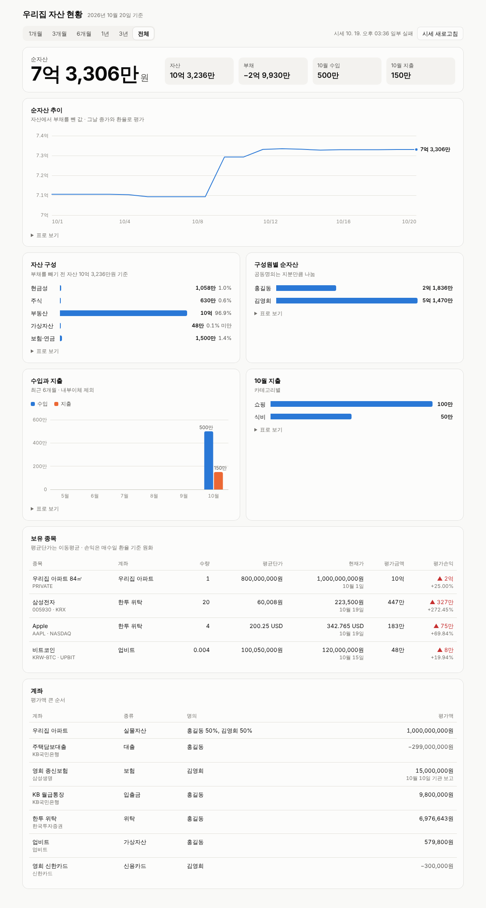

# AssetHub · 우리집 자산허브

가족 모두의 금융 자산, 거래, 세금 자료를 한곳에 모아 현황과 수익률을 자동으로 관리하는 자가 호스팅 웹 프로그램입니다.
가족 데이터만 다루며 외부에 서비스하지 않습니다.

## 구조

```
[소스]       증권사 API · CODEF(은행·카드·홈택스·연금) · 업비트 · 시세 · 엑셀/수동
   │
[수집층]     소스별 어댑터, 원본 보관(raw_record)
   │
[정규화층]   스키마 통일 · 중복 제거 · 이체 짝 맞춤 · 자동 분류
   │
[데이터 모델] 가구 > 구성원 > 계좌 > 거래 / 종목 · 시세 · 환율
   │
[계산 엔진]  평가액 · 수익률(TWR, XIRR) · 실현/미실현 손익 · 세금 추정
   │
[화면]       순자산 대시보드 · 자산배분 · 수입/지출 · 세금 캘린더 · 알림
```

## 로드맵

1. **기반** ✅: 데이터 모델, API·엑셀 가져오기, 시세·환율 수집, 순자산 대시보드
2. **자동 수집**: 한국투자증권 API, 업비트, CODEF 은행·카드, 이체 매칭, 자동 분류, 원가·수익률 엔진
3. **세금·기타 자산**: 홈택스, 국민연금, 보험, 부동산 시세, 세금 추정
4. **가족 운영**: 구성원별 권한, 수집 실패·인증서 만료 알림, 월간 리포트

## 폴더

| 경로 | 내용 |
| --- | --- |
| `db/migrations/` | 데이터베이스 구조 변경 이력 (`0001` 스키마, `0002` 금융기관·카테고리, 이후 변경분) |
| `db/sample.sql` | 예제 가구 데이터 |
| `db/tests.sql` | 예제 데이터 기준 검증 |
| `docs/data-model.md` | 데이터 모델 설계 설명 |
| `scripts/db-check.sh` | 빈 DB에 스키마를 올리고 검증 실행 |
| `backend/` | FastAPI 백엔드 (`assethub` 패키지, 테스트) |
| `backend/assethub/importer/` | 엑셀·CSV 가져오기 (형식 판별, 순서·잔액 검증, 중복 판정) |
| `backend/assethub/market/` | 시세·환율 수집 (네이버 국내·해외 주식, 업비트, 네이버 환율) |
| `backend/assethub/brokers/` | 증권사 API 어댑터 (키움, 한국투자)와 동기화·잔고 맞춤 |
| `backend/assethub/valuation.py` | 평가 엔진 (날짜별 평가액, 이동평균 원가, 자산 구성) |
| `frontend/` | 대시보드 (React + Vite, 차트는 직접 그린 SVG) |

## Windows에서 실행

명령 프롬프트(cmd)에서 아래 순서대로 실행합니다.

**1. 필요한 프로그램 설치** (이미 있는 것은 건너뛰어도 됩니다)

```bat
winget install -e --id Git.Git
winget install -e --id OpenJS.NodeJS.LTS
winget install -e --id astral-sh.uv
winget install -e --id PostgreSQL.PostgreSQL.17 --interactive
```

PostgreSQL 설치 화면에서 **비밀번호를 정하고 기억해 두세요**. 나머지는 기본값(포트 5432)으로 두면 됩니다.
설치가 끝나면 명령 프롬프트를 **닫고 새로 엽니다** (새로 설치한 명령을 인식하게).

**2. 코드 받기와 준비**

```bat
cd %USERPROFILE%
git clone -b claude/peaceful-cray-pw42qm https://github.com/leesome0501/stopwatch.git asset-hub
cd asset-hub
setup.cmd
```

`setup.cmd`가 PostgreSQL 비밀번호를 묻고, 데이터베이스와 테이블을 만들고, 화면을 빌드합니다.
예제 가구 데이터를 넣을지도 묻습니다. 화면을 먼저 구경하려면 `y`를 누르세요.
접속 정보는 `backend\.env`에 저장되고 git에는 올라가지 않습니다. 다시 실행해도 기존 데이터는 지우지 않습니다.

**3. 실행**

`asset-hub` 폴더의 `start.cmd`를 더블클릭하면 브라우저에서 `http://localhost:8000/`이 열립니다. 검은 창을 닫으면 꺼집니다.
이 PC에서만 접속되도록 열어 둡니다 (아직 로그인 기능이 없으므로).

**업데이트**: 새 기능이 올라오면 `start.cmd` 창을 닫고 `update.cmd`를 더블클릭합니다. 코드를 받고, 데이터베이스 변경을 적용하고(기존 데이터는 그대로), 화면을 다시 빌드합니다.

**시세 자동 수집**: 작업 스케줄러에 `collect.cmd`를 평일 저녁(예: 18:40)과 아침(예: 07:10)에 실행하도록 등록하세요.

## 백엔드 실행 (Mac·Linux)

PostgreSQL 16 이상과 [uv](https://docs.astral.sh/uv/)가 필요합니다.

```bash
cd backend
uv sync
uv run python -m assethub.setup_local      # DB 만들기, 마이그레이션, backend/.env 저장
uv run uvicorn assethub.main:app --reload
```

서버는 시작할 때마다 밀린 데이터베이스 변경(`db/migrations/`)을 자동으로 적용합니다.

대시보드를 함께 띄우려면 한 번 빌드해 둡니다. 빌드된 화면은 FastAPI가 `/`에서 서빙합니다.

```bash
cd frontend && npm install && npm run build
```

`http://localhost:8000/` 이 대시보드, `http://localhost:8000/docs` 가 API 문서입니다.
화면을 고칠 때는 `npm run dev`(5173 포트)로 띄우면 `/api` 요청이 8000 포트로 넘어갑니다.
아직 로그인 기능이 없으므로 집 안 네트워크나 VPN 뒤에서만 띄우세요.

## 주요 API

| 기능 | 경로 |
| --- | --- |
| 가구·구성원 | `POST /api/households`, `POST /api/households/{id}/members` |
| 계좌 (공동명의 지분 포함) | `POST /api/households/{id}/accounts`, `PATCH /api/accounts/{id}` |
| 종목·시세·환율 | `POST /api/instruments`, `PUT /api/instruments/{id}/prices`, `PUT /api/fx-rates` |
| 거래 | `GET·POST /api/accounts/{id}/transactions`, `PATCH·DELETE /api/transactions/{id}` |
| 현황 | `GET /api/households/{id}/summary`, `/cashflow?month=YYYY-MM`, `/unmatched-transfers` |
| 엑셀 가져오기 | `POST /api/accounts/{id}/imports/preview`, `POST /api/accounts/{id}/imports` |
| 표준 양식 | `GET /api/import-template` |
| 대시보드 | `GET /api/households/{id}/dashboard?range=1m·3m·6m·1y·3y·all` |
| 시세 수집 | `POST /api/market/refresh`, `GET /api/market/runs` |

금액은 정밀도를 지키려고 JSON에서 문자열(`"1145000.0000"`)로 주고받습니다. 화면 전용인 대시보드와 현황 API만 숫자로 줍니다.

## 엑셀 가져오기

계좌 화면에서 파일을 올리면 미리보기로 행마다 새 거래, 중복, 오류와 자동 분류 결과를 보여주고, 확인하면 새 거래만 저장합니다.

- **읽는 파일**: `.xlsx`, 옛 `.xls`, 은행이 내려주는 "HTML 표로 된 .xls", CSV(UTF-8, CP949). 확장자가 아니라 내용으로 판별합니다.
- **은행 형식**: 우리, 신한, 하나(법인·개인), IBK, 이체내역 형식을 알아보고, 그 밖의 은행은 헤더 이름(거래일시, 출금, 입금, 잔액, 적요 등)으로 컬럼을 찾습니다.
- **AssetHub 표준 양식**: 증권 매매, 배당, 환전, 기초잔액처럼 은행 형식으로 표현할 수 없는 자료를 채워 올리는 양식입니다.
- **순서**: 최신이 위에 있는 은행 파일도 과거→최신 순서로 바로잡아 저장합니다.
- **중복**: 거래 후 잔액이 있으면 "한국 날짜 + 금액 + 잔액"으로 판정합니다. 시각이 있는 파일과 날짜만 있는 파일이 겹쳐도 같은 거래로 알아봅니다. 같은 파일을 다시 올려도 안전합니다.
- **기초잔액**: 계좌의 첫 업로드라면 첫 거래의 잔액에서 기초잔액을 계산해 넣어, 계산 잔액이 은행 잔액과 맞게 합니다.
- **잔액 검증**: 파일 안에서 잔액이 이어지지 않거나, 저장 후 계산 잔액이 파일의 마지막 잔액과 다르면 경고합니다. 빠진 거래나 다른 계좌의 파일을 잡아냅니다. 파일의 계좌번호가 계좌와 다를 때도 경고합니다.
- **자동 분류**: 파일에 적힌 카테고리, 가구의 분류 규칙, 같은 적요의 과거 거래, 같은 거래처의 과거 거래 순서로 카테고리를 채웁니다.

은행 형식, 중복 판정, 순서·잔액 검증 규칙은 사업자관리 프로젝트의 은행 거래내역 가져오기에서 실제로 겪은 사례를 옮겨 왔습니다.

## 증권사 연결 (키움, 한국투자)

관리 화면의 **증권사 연결**에서 증권사 Open API 키를 등록하면 거래와 잔고를 자동으로 받습니다. 조회만 하고 주문은 하지 않습니다.

1. 증권사에서 본인 명의로 앱키를 발급받습니다.
   - **키움**: [openapi.kiwoom.com](https://openapi.kiwoom.com)에서 계좌를 등록하고 앱키를 받습니다. 발급 전에 이 PC의 공인 IP를 등록해야 하고, 3개월 동안 접속하지 않으면 자동 해지됩니다.
   - **한국투자**: [KIS Developers](https://apiportal.koreainvestment.com)에서 HTS ID에 연결된 계좌로 실전 앱키를 신청합니다. 토큰을 발급할 때마다 카카오톡 알림이 오므로, AssetHub는 토큰을 저장해 하루 한 번만 발급받습니다.
2. **연결 추가**에서 증권사, 명의자, 앱키를 넣으면 증권사에 실제로 확인한 뒤 저장합니다. 한국투자는 계좌번호(예: `12345678-01`)도 넣습니다.
3. 증권사 계좌를 AssetHub 계좌에 연결하고, 거래를 받기 시작할 날짜를 고릅니다.
4. **지금 동기화**를 누르거나 `collect.cmd`를 매일 실행하도록 작업 스케줄러에 등록합니다.

| | 키움 | 한국투자 |
| --- | --- | --- |
| 거래 | 위탁종합거래내역(입출금·배당·이자·세금·수수료 포함) | 체결 내역만 |
| 잔고 | 예수금(D+2), 보유 종목 | 예수금(D+2), 보유 종목 |
| 해외주식 | 아직 미지원 (외화 예수금만 반영) | 아직 미지원 |

**잔고 맞춤**: 동기화가 끝나면 계산한 보유 수량과 현금을 증권사 잔고와 비교합니다. 첫 동기화에서는 시작일 이전부터 있던 보유분과 현금이 "기초 보유"로 들어갑니다. 이후에는 API가 주지 않는 수수료, 세금, 입출금, 배당(한국투자) 차액이 "잔고 맞춤"으로 들어갑니다. 그래서 순자산은 항상 증권사 잔고와 같습니다. 잔고 맞춤 행은 거래내역 화면에서 카테고리를 붙일 수 있습니다.

**보안**: 앱키와 토큰은 암호화해서 DB에 저장하고 화면이나 API 응답에 다시 내보내지 않습니다. 암호화 키는 `backend\.env`의 `ASSETHUB_SECRET_KEY`이므로 이 파일을 함께 백업하세요. 잃어버리면 앱키를 다시 입력하면 됩니다. 가족 계좌는 각자 본인 명의 키로 연결합니다.

**검증 상태**: 두 어댑터는 증권사 공식 스펙의 필드 이름으로 만든 가짜 서버로 시험했습니다. 실제 증권사 서버로는 아직 시험하지 못했습니다. 처음 연결할 때 결과가 이상하면 동기화 결과 메시지를 알려 주세요.

## 시세·환율 수집

거래 내역에 나오는 종목과 외화만 골라, DB에 없는 기간의 일별 종가를 받아 옵니다. 마지막 일주일은 매번 다시 받아 수정된 종가를 반영합니다.

| 대상 | 소스 | 비고 |
| --- | --- | --- |
| 국내 주식·ETF (시장 `KRX`, `KOSPI`, `KOSDAQ`) | 네이버 금융 | 종목코드 6자리 |
| 미국 주식·ETF (시장 `NASDAQ`, `NYSE`, `AMEX`) | 네이버 금융 | 네이버 코드(`AAPL.O`, `BRKb` 등)를 자동으로 찾아 `price_code`에 저장 |
| 가상자산 (시장 `UPBIT`, 종목코드 `KRW-BTC`) | 업비트 공식 API | |
| 환율 (USD, JPY, EUR 등 → 원) | 네이버 금융 | 엔화는 100엔 시세를 1엔으로 환산 |
| 부동산, 비상장 | 수동 입력 | `PUT /api/instruments/{id}/prices`. 수동 시세는 수집기가 덮어쓰지 않음 |

네이버 금융 API는 공식 공개 API가 아니라 화면이 쓰는 내부 API라서 형식이 바뀔 수 있습니다. 소스마다 어댑터를 분리해 두었으므로, 2단계에서 한국투자증권 API를 같은 방식으로 붙이면 됩니다.

매일 장 마감 후 한 번 돌리면 됩니다. 대시보드의 "시세 새로고침" 단추로도 실행할 수 있습니다.

```bash
# crontab -e : 평일 18:40(한국 시간)과 다음 날 07:10(미국 장 마감 후)
40 18 * * 1-5  cd ~/asset-hub/backend && DATABASE_URL=postgresql:///assethub .venv/bin/python -m assethub.collect
10 7  * * 2-6  cd ~/asset-hub/backend && DATABASE_URL=postgresql:///assethub .venv/bin/python -m assethub.collect
```

## 화면

| 화면 | 하는 일 |
| --- | --- |
| **대시보드** | 순자산, 추이, 자산 구성, 수입·지출, 보유 종목, 계좌별 평가액 |
| **거래내역** | 계좌·기간·카테고리·검색으로 거래를 찾고, 카테고리와 메모를 고치고, 직접 입력하거나 지웁니다. 카테고리를 바꾸면 "앞으로도 이렇게 분류할까요?"를 물어 규칙을 만들고, 지금 보이는 같은 거래도 함께 바꿉니다. |
| **가져오기** | 계좌를 고르고 은행 엑셀이나 표준 양식을 끌어 놓으면 미리보기(새 거래·중복·오류·자동 분류)를 보여주고, 확인하면 새 거래만 저장합니다. |
| **관리** | 가족 구성원, 계좌(공동명의 지분, 마감, 보험·연금 평가액 기록), 종목(부동산 시세 직접 입력), 분류 규칙과 카테고리, 가구 전체 삭제 |

처음 실행하면 가구 이름과 본인 이름만 묻고 관리 화면으로 넘어갑니다. 예제 데이터로 시작했다면 관리 화면 맨 아래 "가구 삭제"로 지우고 새로 시작하세요.

## 대시보드



- **순자산**: 자산, 부채, 이번 달 수입·지출과 지난 30일 변화.
- **순자산 추이**: 기간(1개월~전체)을 고르면 그날 종가와 환율로 다시 평가한 값을 그립니다. 마우스나 좌우 화살표로 날짜별 값을 봅니다.
- **자산 구성, 구성원별 순자산**: 공동명의는 지분만큼 나눕니다.
- **수입과 지출**: 최근 6개월, 이번 달 카테고리별 지출. 내부이체는 빠집니다.
- **보유 종목**: 이동평균 단가, 현재가, 평가손익. 원화 손익은 매수일 환율 기준이라 해외주식은 환율 효과가 포함됩니다. 손익은 한국 관례대로 상승 ▲빨강, 하락 ▼파랑입니다.
- **계좌**: 평가액, 명의, 기관 보고 기준일.

모든 차트에 "표로 보기"가 있고, 휴대폰 화면과 다크 모드를 지원합니다. 오래된 시세나 시세가 없는 종목은 보유 종목 위에 따로 알려 줍니다.

## 검증 실행

```bash
scripts/db-check.sh                 # 스키마와 뷰를 예제 가구로 검증
cd backend && uv run pytest         # 가져오기·API 테스트 (임시 PostgreSQL 사용, root 불가)
TEST_DATABASE_URL=postgresql:///postgres uv run pytest   # 기존 서버 사용 (CREATE DATABASE 권한 필요)
```
