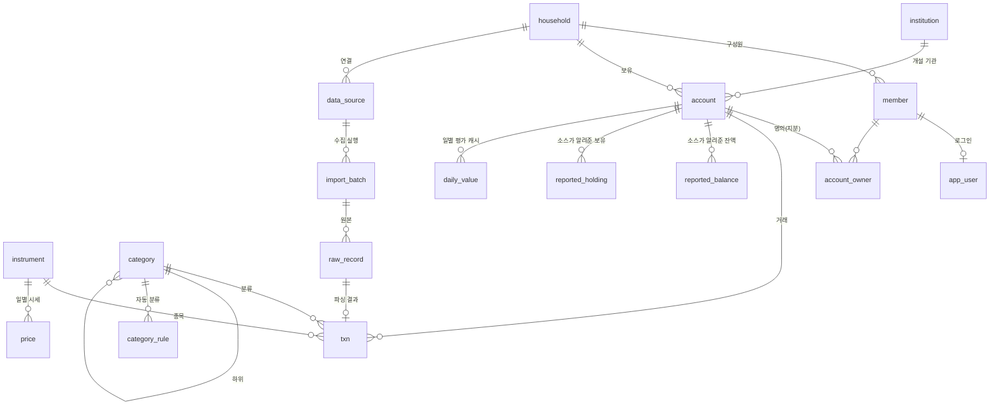

# AssetHub 데이터 모델

1단계(수동·엑셀 입력, 시세 수집, 순자산 대시보드)를 위한 데이터 모델입니다.
2단계 이후 자동 수집(증권사 API, CODEF, 업비트)이 붙어도 이 모델은 바뀌지 않고, 수집기가 같은 테이블에 행을 넣기만 하도록 설계했습니다.

실제 정의는 [`db/schema.sql`](../db/schema.sql), 예제는 [`db/sample.sql`](../db/sample.sql)에 있습니다.

## 핵심 원칙

1. **거래(txn)가 진실의 원천이다.** 잔고, 보유 수량, 평가액, 순자산은 저장하지 않고 뷰로 계산합니다. 거래를 고치면 모든 숫자가 저절로 맞습니다.
2. **부호는 그 계좌 입장에서 정한다.** 돈이나 수량이 들어오면 양수, 나가면 음수입니다. 카드 사용은 음수, 대출 잔액도 음수라서 모든 계좌를 그냥 더하면 순자산이 됩니다.
3. **한 사건이 두 계좌에 걸치면 `group_id`로 묶는다.** 통장에서 증권사로 보낸 돈은 두 행이고 같은 `group_id`를 가집니다. 이체 카테고리(`kind = 'transfer'`)는 수입·지출 통계에서 빠집니다.
4. **원본은 버리지 않는다.** 엑셀 한 행, API 응답 한 건이 `raw_record`에 그대로 남고, 파서를 고치면 다시 돌릴 수 있습니다.
5. **같은 거래는 한 번만 들어간다.** `txn`은 `(account_id, dedupe_key)`가 유일합니다. 같은 엑셀을 두 번 올려도 안전합니다.
6. **기준 통화는 KRW다.** 외화는 `fx_rate`로 환산하고, 그날 환율이 없으면 직전 영업일 값을 씁니다.

## 관계도



## 테이블 묶음

| 묶음 | 테이블 | 역할 |
| --- | --- | --- |
| 사람 | `household`, `member`, `app_user` | 가구, 구성원(부양가족 여부 포함), 로그인 계정과 권한 |
| 계좌 | `institution`, `account`, `account_owner` | 기관, 계좌 17종, 공동명의 지분 |
| 시장 | `instrument`, `price`, `fx_rate` | 종목 마스터, 일별 종가, 원화 환율 |
| 거래 | `txn` | 모든 입출금·매매·배당·환전·이체 |
| 분류 | `category`, `category_rule` | 2단 카테고리, 적요·가맹점 기반 자동 분류 규칙 |
| 수집 | `data_source`, `import_batch`, `raw_record` | 연결 정보(암호화), 수집 실행 기록, 원본 보관 |
| 대사 | `reported_balance`, `reported_holding` | 기관이 알려준 잔액·보유. 계산값과 비교하거나, 거래 내역이 없는 계좌의 평가 근거 |
| 캐시 | `daily_value` | 일별 계좌 평가액. 순자산 추이와 TWR 계산용이며 언제든 재계산 가능 |

## 계좌 평가 방식

계좌마다 `valuation_method`를 정합니다.

- **`transactions`**: 거래를 합산해 평가합니다. 현금 잔액에 보유 수량 × 최신 시세 × 환율을 더합니다. 은행, 증권, 카드, 코인, 대출, 부동산이 해당합니다.
- **`reported`**: 기관이 알려준 최신 잔액(`reported_balance`)을 그대로 씁니다. 보험 해지환급금, 국민연금 예상액처럼 거래 내역을 받을 수 없는 자산이 해당합니다.

부동산과 차량은 계좌 하나에 종목 하나(수량 1)를 넣고, 시세를 `price`에 `source = 'manual'`로 기록합니다. 나중에 실거래가 API가 붙으면 source만 바뀝니다.

## 상황별 기록 방법

| 상황 | 기록 |
| --- | --- |
| 기존 잔액에서 시작 | `adjustment` 한 행 (기초잔액) |
| 급여 입금 | `cash_in`, 카테고리 급여 |
| 카드 사용 | 카드 계좌에 `cash_out` 음수, 카테고리 지출 |
| 카드 대금 결제 | 통장 `cash_out` + 카드 `cash_in`, 같은 `group_id`, 카테고리 카드대금(이체) |
| 증권사로 입금 | 통장 `cash_out` + 증권 `cash_in`, 같은 `group_id`, 카테고리 투자이체 |
| 주식 매수 | `buy`, 수량 양수, `amount` = -(수량×단가 + 수수료 + 세금) |
| 주식 매도 | `sell`, 수량 음수, `amount` = 수량×단가 - 수수료 - 세금 |
| 환전 (원화 → 달러) | 같은 계좌에 `fx` 두 행 (KRW 음수, USD 양수), 같은 `group_id` |
| 해외 배당 | `dividend`, `amount` = 세후 입금액, `tax` = 원천징수액 |
| 이미 가진 주식 등록 | `instrument_in`, `unit_price` = 평균 매입가, `amount` = 0 |
| 대출 | `adjustment` 음수로 시작, 원금 상환은 통장과 짝을 이루는 `cash_in` |
| 액면분할 | `split`, 늘어난 수량만큼 양수 |

`balance_after`는 은행 파일이 알려준 거래 후 잔액입니다. 잔액 계산에는 쓰지 않고, 중복 판정과 잔액 대사에만 씁니다.

`fee`와 `tax` 컬럼은 정보용입니다. 금액은 이미 `amount`에 반영되어 있으므로 잔액 계산에서 다시 빼지 않습니다.

## 중복 방지 키

`dedupe_key`는 다음 순서로 정합니다.

1. 소스가 거래 고유번호를 주면 그 값.
2. 거래 후 잔액이 있으면 `bal:한국날짜|통화|금액|잔액`. 같은 거래라도 어떤 파일은 시각을, 어떤 파일은 날짜만 주기 때문에 시각은 넣지 않습니다. 잔액은 그 순간의 누적값이라 같은 날 같은 금액에 잔액까지 같은 다른 거래는 사실상 없습니다.
3. 둘 다 없으면 `(일시, 유형, 금액, 종목, 수량, 적요)`의 해시에 같은 파일 안에서의 순번을 붙입니다. 같은 시각에 같은 금액으로 커피 두 잔을 결제한 경우를 구분하기 위해서입니다.

수동 입력은 `manual:UUID`를 씁니다. 거래를 지우면 행을 없애지 않고 `status = 'void'`로 둡니다. 그래야 같은 파일을 다시 올려도 지운 거래가 되살아나지 않습니다.

## 제공하는 뷰

| 뷰 | 내용 |
| --- | --- |
| `v_cash_balance` | 계좌·통화별 현금 잔액 |
| `v_position` | 계좌·종목별 보유 수량 |
| `v_txn_krw` | 거래일 환율로 KRW 환산한 거래 |
| `v_account_value` | 계좌별 현재 평가액 (KRW) |
| `v_net_worth` | 가구 자산, 부채, 순자산 |
| `v_member_net_worth` | 구성원별 순자산 (공동명의는 지분만큼) |
| `v_monthly_cashflow` | 월별·상위 카테고리별 수입과 지출 (이체 제외) |
| `v_unmatched_transfer` | 짝이 안 맞는 이체. 수집 후 점검 화면용 |

함수 `fx_to_krw(통화, 날짜)`와 `price_asof(종목, 날짜)`는 특정일 기준 환율과 시세를 돌려줍니다. 과거 날짜의 평가액도 같은 방식으로 계산합니다.

## 일부러 뒤로 미룬 것

- **매입 원가와 실현손익**: 이동평균법과 선입선출법은 거래를 시간순으로 훑어야 해서 SQL 뷰보다 애플리케이션 계산 엔진이 맞습니다. 2단계에서 구현하고, 결과는 `daily_value`처럼 재계산 가능한 캐시로 둡니다.
- **수익률 (TWR, XIRR)**: `daily_value`의 평가액과 외부 순유입으로 계산합니다. 계산 엔진과 함께 구현합니다.
- **세금 규칙**: 금융소득종합과세 기준, 해외주식 양도세 공제, ISA·연금 한도는 연도별 규칙 테이블로 3단계에 추가합니다. 지금은 계좌 유형과 거래의 `tax` 컬럼으로 필요한 원자료를 모읍니다.
- **카드 할부, 대출 상환 스케줄, 예적금 만기 이자 예측**: 필요해지면 계좌에 딸린 별도 테이블로 붙입니다.

## 검증

```bash
scripts/db-check.sh                        # 임시 PostgreSQL을 띄워 검증 (root 계정에서는 불가)
DATABASE_URL=postgres://... scripts/db-check.sh   # 기존 서버의 빈 DB로 검증
```

예제 가구는 통장, 증권(원화·달러), 카드, 코인, 공동명의 아파트, 보험, 주택담보대출을 갖고 있습니다.
검증 스크립트는 잔액, 평가액, 순자산, 구성원별 지분, 월 수입·지출을 손으로 계산한 값과 비교하고, 중복 거래와 잘못된 매수가 거부되는지 확인합니다.
